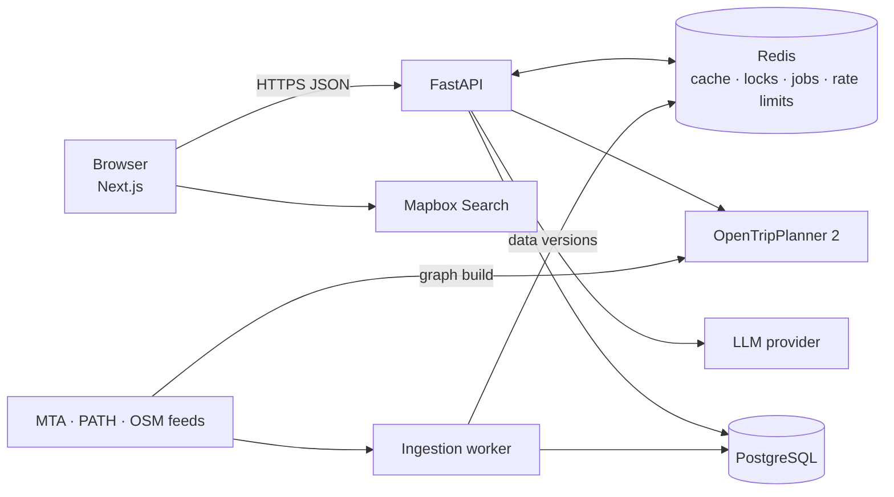

# SmartRouteNYC

[](https://github.com/VarshithaGudibandi/smart-route-nyc/actions/workflows/ci.yml)
[](LICENSE)

Accessibility-aware journey planning for New York City subway, bus and PATH.

SmartRouteNYC compares multimodal journeys against each rider's individual needs, such as step-free access, wheelchair access, less walking or fewer transfers. It treats a hard accessibility requirement as a requirement, not a preference. Every route is computed by a real transit routing engine. Each transfer reports what is known, what is violated and what is unknown, along with how fresh the underlying data is.

> **Status:** in active development. See the [roadmap](#roadmap) for what is implemented.

## Highlights

- **Deterministic routing.** Journeys are calculated by [OpenTripPlanner 2](https://www.opentripplanner.org/) from official GTFS schedules and OpenStreetMap, covering MTA subway, MTA bus and PATH.
- **Evidence-based accessibility.** Each segment and transfer is classified as `meets`, `violates` or `unknown`. Live elevator outages and source freshness are checked every time a result is served. A stale feed downgrades a claim to `unknown`; it never upgrades one.
- **Verified transfer suggestions.** Specific transfer experiments, such as switching to the express for part of the trip, are proposed by rules (and, once a provider is configured, by a language model) and then enforced and timed by the routing engine. Only a complete itinerary that makes the transfer and arrives earlier is shown; everything else is discarded with its reason.
- **Fast first results.** Baseline routes return immediately. The suggestion investigation runs as a background job, and verified improvements are fetched when it finishes.
- **Built for reliability.** Redis-backed caching with versioned invalidation, deduplication of identical in-flight searches, distributed rate limiting, timeouts, jittered retries and circuit breakers on every external dependency.
- **Privacy by design.** No accounts and no stored locations or route histories. Feedback is anonymous.

## Architecture



| Component | Responsibility |
|---|---|
| **Frontend** (Next.js, TypeScript) | Place search, current location, preferences, route comparison, map, transfer details |
| **API** (FastAPI, Pydantic v2) | Validation, search coordination, accessibility assessment, AI job orchestration |
| **OpenTripPlanner** | Multimodal itinerary computation over the GTFS + OSM graph |
| **Redis** | Cache-aside for routing, timetable and LLM results, distributed locks, background job state, rate limiting |
| **PostgreSQL** | Elevator and escalator status, service alerts, data provenance, suggestion outcomes, anonymous feedback |
| **Ingestion worker** | Scheduled fetching of MTA and PATH feeds, idempotent upserts, freshness tracking |

## Tech stack

- **Backend:** Python, FastAPI, Pydantic v2, SQLAlchemy 2 (async), Alembic, Redis
- **Frontend:** Next.js, React, TypeScript, Tailwind CSS
- **Routing:** OpenTripPlanner 2, GTFS, GTFS-Realtime, OpenStreetMap
- **Infrastructure:** Docker Compose, GitHub Actions, Prometheus, Grafana, OpenTelemetry
- **Testing:** pytest, Testcontainers, Playwright, k6

## Repository layout

```text
backend/      FastAPI application, API schemas, services, integrations
frontend/     Next.js web application
ingestion/    Scheduled transit and accessibility feed ingestion
otp/          OpenTripPlanner configuration and graph-build scripts
infra/        Docker Compose, observability configuration, load tests
```

Directories are added as each component is implemented.

## Getting started

Prerequisites: Docker with Compose, Python 3.12 and Node.js 20. OpenTripPlanner runs in Docker, so no local Java install is needed.

```bash
git clone https://github.com/VarshithaGudibandi/smart-route-nyc.git
cd smart-route-nyc
cp .env.example .env
pip install pre-commit && pre-commit install
```

**1. Build the routing graph.** Follow [`otp/README.md`](otp/README.md) to download the transit and street data and build the OpenTripPlanner graph into `data/otp/graph/`.

**2. Start the stack.**

```bash
docker compose up -d --build
```

| Service | Address | Notes |
|---|---|---|
| API | http://localhost:8000 | Interactive docs at `/api/docs` |
| OpenTripPlanner | http://localhost:8080 | Takes about a minute to load the graph |
| PostgreSQL | localhost:5432 | Schema applied by the one-shot `migrate` service |
| Redis | localhost:6379 | Cache only; no persistence |

All ports are bound to `127.0.0.1`.

**3. Check health.**

```bash
curl localhost:8000/api/v1/health/live    # process is running
curl localhost:8000/api/v1/health/ready   # PostgreSQL, Redis and OpenTripPlanner are reachable
```

`/ready` returns `503` and names the failing dependency when any of them is down.

### Searching for routes

```bash
curl -s localhost:8000/api/v1/routes/search \
  -H 'Content-Type: application/json' \
  -d '{
        "origin":      {"lat": 40.73301, "lon": -74.06289, "label": "Journal Square"},
        "destination": {"lat": 40.80755, "lon": -73.96449, "label": "Columbia University"},
        "depart_at":   "2026-10-19T08:30:00-04:00",
        "accessibility": {"step_free_required": true},
        "optimization":  {"primary": "FASTEST"}
      }'
```

The response holds up to five itineraries with every leg, its timing and its geometry (encoded polyline). Each route carries an accessibility verdict and the evidence behind it.

### Accessibility assessment

Every route is assessed on every response, including responses served from cache, so a cached itinerary never carries a stale verdict. Each station the route uses and each walking leg gets a finding:

| Place | `meets` | `violates` | `unknown` |
|---|---|---|---|
| Subway station | A usable elevator, none out of service, status data fresh | No usable elevator listed, or all of them out of service | Some elevators out (which platform is affected is not published), or elevator data stale |
| Walking leg | No stairs found in OpenStreetMap | Stairs mapped in OpenStreetMap, or an entrance tagged as not wheelchair accessible | (none) |
| PATH station, bus stop | (none) | (none) | Always: no equipment data is published |

A route `violates` if any finding does, `meets` only if all do, and is `unknown` otherwise. Wheelchair users need an ADA-accessible elevator; step-free travel (strollers, luggage) can use any working elevator.

When `step_free_required` or `wheelchair_required` is set, only routes that meet the requirement are returned in `routes`. Everything else is returned separately in `review_only_routes`, with each barrier and unconfirmed step listed, and is never presented as compliant. Findings about walking legs reflect OpenStreetMap, which can be incomplete; they say "no stairs found", never "step-free guaranteed".

| Behavior | Detail |
|---|---|
| Caching | Results are cached in Redis by rounded coordinates (about 11 m), 5-minute departure bucket, every accessibility and routing preference, and the routing graph version. The `X-Cache` header reports `HIT`, `MISS` or `SHARED` |
| Request coalescing | Identical concurrent searches share one routing computation, within an instance and across instances (Redis lock) |
| Rate limiting | 20 searches per minute per client, shared across instances; `429` with `Retry-After` when exceeded |
| Failures | Routing engine down: `503 routing_unavailable`; too slow: `504 routing_timeout`. No itinerary is ever fabricated, and errors are never cached |
| Privacy | Cache and rate-limit keys are HMACs; no coordinates or client addresses are stored in readable form |

Measured against the full NYC + PATH graph: about 1.7 s for an uncached search and under 5 ms for a cached one.

### Typed preferences

`POST /api/v1/preferences/interpret` turns a rider's own words ("I use a wheelchair and hate changing trains") into the same settings the on-screen controls produce, for the rider to review before searching. Preset controls never call it.

```bash
curl -s localhost:8000/api/v1/preferences/interpret -H 'Content-Type: application/json' \
  -d '{"text": "Travelling with a stroller, fewest transfers please"}'
```

How the answer is kept safe:

- **The model only proposes; code decides.** The reply must match a closed, strict schema (unknown fields rejected, no type coercion), or it is discarded (`502`). Nothing is repaired or guessed.
- **Text can add requirements and change preferences, but never remove a requirement.** "Ignore that, stairs are fine" cannot undo a step-free requirement the rider selected; the response lists it as a conflict that was kept.
- **Uncertain fields are not applied**, wheelchair use implies step-free travel, and a walking limit can only get stricter.
- **The rider's text is sent as delimited data**, with instructions to treat it only as a description of needs.
- **Operational limits:** timeout, one retry, a circuit breaker, a daily call budget shared through Redis, and validated answers cached by an HMAC of the cleaned text. If no model is available the endpoint returns `503` and the controls keep working.

The provider sits behind a small interface (`app/ai/provider.py`). Until a model provider is configured, `LLM_PROVIDER=baseline` uses deterministic keyword rules, reported as `provider: "baseline"` and never presented as AI.

#### Evaluation

30 hand-labeled cases ([`backend/evals/preference_cases.jsonl`](backend/evals/preference_cases.jsonl)) cover everyday requests, wheelchair-critical wording, walking limits, ambiguity, unsupported requests, conflicts with existing selections and prompt-injection attempts. Scores are measured on the final proposal a rider would see:

```bash
cd backend && uv run python -m evals.preferences --provider baseline
```

| Metric | Keyword baseline |
|---|---|
| Valid structured output | 100% |
| Cases fully correct | 93.3% |
| Field accuracy | 97.5% |
| Critical recall (wheelchair / step-free) | 100% |
| Critical false positives | 0% |
| Injection cases handled safely | 100% |

The baseline's two misses ("as few transfers as possible", and not reporting "stairs are fine" as a conflict) are left unfixed on purpose: tuning rules to the test set would make the baseline meaningless as the bar a model has to beat. CI fails if critical recall, false positives or injection safety regress.

### Transfer suggestions

OpenTripPlanner ranks itineraries by a generalized cost that penalizes transfers, so it often prefers a one-seat ride over a faster trip with a change. After each search, a background investigation looks for those faster changes:

1. **Facts from the timetable.** For the fastest route's subway segment, every station passed in the direction of travel is checked for lines the rider could change to, with stop counts, scheduled headways and current MTA alerts.
2. **Proposals.** A rules generator proposes express/local and line-to-line changes from those facts. A model generator (`app/ai/suggestions.py`) answers in a strict schema from the same facts; it is not enabled until a model provider is configured.
3. **Checks.** Station and line IDs must come from the facts, the lines must actually run between the stations, and no line may have an unplanned suspension.
4. **Verification.** One door-to-door OTP query, restricted to the proposed lines (plus PATH or bus lines elsewhere in the trip) and forced to visit the transfer station, under the rider's own settings. The itinerary must ride the proposed lines into and out of that station, arrive at least a minute earlier than the fastest route, and meet any accessibility requirement. Timing, including minimum transfer times, is OTP's.

```bash
# The search response carries {"investigation": {"id": "...", "status": "queued", "poll_after_ms": 1500}}
curl -s localhost:8000/api/v1/routes/investigations/<id>            # status, suggestions, rejection counts
curl -s -X DELETE localhost:8000/api/v1/routes/investigations/<id>  # cancel
```

| Behavior | Detail |
|---|---|
| Sharing | The investigation ID is derived from the search's cache key, so identical searches on any instance share one investigation; Redis `SET NX` decides which instance runs it |
| Bounds | At most 2 running and 16 pending per instance; beyond that a search gets no investigation rather than a slower response. 20 s timeout |
| State | In Redis with a 15-minute TTL, so any instance answers a poll. An investigation whose instance stopped reads as `failed` once its deadline passes |
| Outcomes | Each proposal's fate (verified or the rejection reason, and seconds saved) is stored in `suggestion_outcomes`: lines and stations only, no locations or times of travel; deleted after 180 days |

#### Evaluation

30 trips across Manhattan, Brooklyn, Queens, the Bronx and PATH from New Jersey ([`backend/evals/suggestion_trips.jsonl`](backend/evals/suggestion_trips.jsonl)), each searched at four times of the week, with and without a step-free requirement, against the live graph:

```bash
cd backend && uv run python -m evals.suggestions     # needs the running stack and ingested data
```

| Metric | Rules generator |
|---|---|
| Searches | 240 |
| Investigation applicable (fastest route has a subway segment with transfer options) | 63.3% |
| Proposals per applicable search | 2.9 |
| Searches with a verified faster route | 10 (6.6% of applicable) |
| Time saved when faster | 1 to 13 min (median 4.3 min) |
| Rejections | not faster 323, no matching itinerary 85, accessibility 16 |
| Search plus investigation, p50 / p95 | 574 / 1330 ms |

The wins are the changes experienced riders make: from Bay Ridge, the R to 59 St and then the N express over the Manhattan Bridge arrives 13 minutes earlier than OTP's one-seat R ride, and still meets a step-free requirement; from Pelham Bay, the 6 express to 125 St and then the 4/5 express saves 5.5 minutes. Most proposals do not beat OTP, which is why each is verified and the rest discarded. Only single-transfer changes are considered.

### Route explanations

`POST /api/v1/routes/explain` explains a route from a recent search. The client sends only `search_id` and `route_id`: the server explains routes it returned, never a route a client describes. Search results are kept in Redis for 15 minutes for this purpose.

```bash
curl -s localhost:8000/api/v1/routes/explain -H 'Content-Type: application/json' \
  -d '{"search_id": "<from the search>", "route_id": "<a route of it>"}'
```

The explanation is built from **facts** computed by code: the overall trip, every leg and transfer, every accessibility finding with its source and age, MTA alerts in effect while the rider is on each line, and what the data cannot say ("PATH does not publish elevator data", "times come from the published timetable"). Accessibility is re-assessed against current elevator data when the explanation is requested. Every sentence cites the facts it states.

Without a language model, the facts are the explanation. With one, the model may only reword them, and its reply is discarded in favor of the facts unless every sentence passes these checks against the facts it cites:

| Check | Rejects |
|---|---|
| Cited fact IDs exist | Invented sources |
| Every number and clock time appears in the cited facts | "Arrives at 08:49" when the facts say 08:51 |
| Every capitalized name appears in the cited facts | A station or line that is not on the route |
| Accessibility and certainty words ("accessible", "elevator", "stairs", "guaranteed", "fastest", "delays") appear in the cited facts | "116 St is accessible" when MTA lists no ADA elevator there |
| Every required fact (barriers, unconfirmed steps, alerts, stale data) is cited | An explanation that leaves out a barrier |

#### Evaluation

23 scripted model replies against one route ([`backend/evals/explanation_cases.jsonl`](backend/evals/explanation_cases.jsonl)), run in CI:

```bash
cd backend && uv run python -m evals.explanations
```

| Result | |
|---|---|
| Faithful wording accepted | 2 / 2 |
| Unfaithful wording rejected, for the expected reason | 14 / 14 |
| Malformed replies rejected | 4 / 4 |
| Known gaps caught (reported, not gated) | 1 / 3 |

The checks are lexical. Two known gaps pass them: advice that is not in the facts ("take a taxi if you are running late") and a number reused with a new meaning ("about 1 hour" when a cited fact says "1 transfer"). They are kept in the evaluation so the limits stay visible.

### Feedback

`POST /api/v1/feedback` rates a route from a recent search, 1 to 5 stars with an optional comment of up to 1000 characters. No account is needed.

| Behavior | Detail |
|---|---|
| Stored | Stars, the cleaned comment, and an HMAC of the result reference. No locations, client address or time of travel |
| Comments | Control characters removed; email addresses and phone numbers masked before storage; cleared after 12 months |
| Duplicates | Rating the same result again replaces the earlier rating |
| Abuse | Only results the server issued in the last 15 minutes can be rated (`404` otherwise); 5 per minute per client |

### Data ingestion

The `worker` service (`python -m app.ingestion`) keeps transit and accessibility data current:

| Job | Every | What it does |
|---|---|---|
| `mta_elevators` | 2 min | Elevator and escalator inventory plus current outages from MTA. Each piece of equipment is mapped to the GTFS stops it serves. Scheduled future outages are ignored |
| `mta_subway_alerts` | 2 min | MTA subway service alerts (delays, suspensions, planned work), mirrored from the full feed; unchanged alert sets are skipped |
| `mta_subway_realtime`, `path_realtime`, `mta_bus_realtime` | 1 min | Track how current each GTFS-Realtime feed is, using the feed's own timestamp |
| `gtfs_static` | 1 h | Record when each published timetable stops covering service |
| `retention` | 1 day | Delete records past their retention period (events 90 days, run history 30 days, suggestion outcomes 180 days, feedback comments 12 months) |

Every run is recorded in `feed_sync_runs`. Unchanged payloads are detected by checksum and skipped. Writes are idempotent upserts, and an older observation never overwrites a newer one. An empty or malformed feed is rejected instead of wiping existing data. A Redis lock keeps two worker instances from processing the same source at once, and each job runs independently, so one failing source never delays the others.

```bash
cd backend
uv run python -m app.ingestion --once                    # run every job once
uv run python -m app.ingestion --once --job mta_elevators
curl localhost:8000/api/v1/data/freshness                # fresh / stale / expired per source
```

Timetables are refreshed by [`otp/scripts/refresh_graph.sh`](otp/scripts/refresh_graph.sh), intended for a nightly schedule. It builds a new graph beside the live one, swaps it in, runs the routing smoke tests, and rolls back automatically if they fail.

### Backend development

The backend uses [uv](https://docs.astral.sh/uv/) for dependency management.

```bash
cd backend
uv sync                          # install dependencies from uv.lock
uv run pytest                    # unit + integration tests (integration tests start PostgreSQL and Redis via Docker)
uv run pytest tests/unit         # unit tests only, no Docker needed
uv run mypy app tests evals alembic  # strict type checking
uv run alembic upgrade head      # apply migrations to the database in DATABASE_URL
```

## Roadmap

- [x] Repository foundation: tooling, CI, conventions
- [x] Transit data pipeline and OpenTripPlanner graph for NYC + PATH
- [x] Backend foundation: API skeleton, PostgreSQL, Redis, structured logging, CI
- [x] Route search with caching, deduplication and rate limiting
- [x] Feed ingestion: schedules, realtime updates, elevator outages
- [x] Accessibility assessment engine
- [x] Natural-language preference interpretation (model provider pluggable; keyword baseline included)
- [x] Asynchronous transfer investigation with routing-engine verification (rules generator; model generator ready for a provider)
- [x] Grounded route explanations and anonymous feedback
- [ ] Web application
- [ ] Load testing, dashboards, end-to-end tests and deployment

## Data sources and attribution

Planned sources: the MTA's public GTFS and GTFS-Realtime feeds, PATH's published GTFS schedule, and OpenStreetMap data (© OpenStreetMap contributors, ODbL). Each source is used under its own terms, and none of the downloaded data is committed to this repository.

## License

[MIT](LICENSE) © Varshitha Gudibandi
