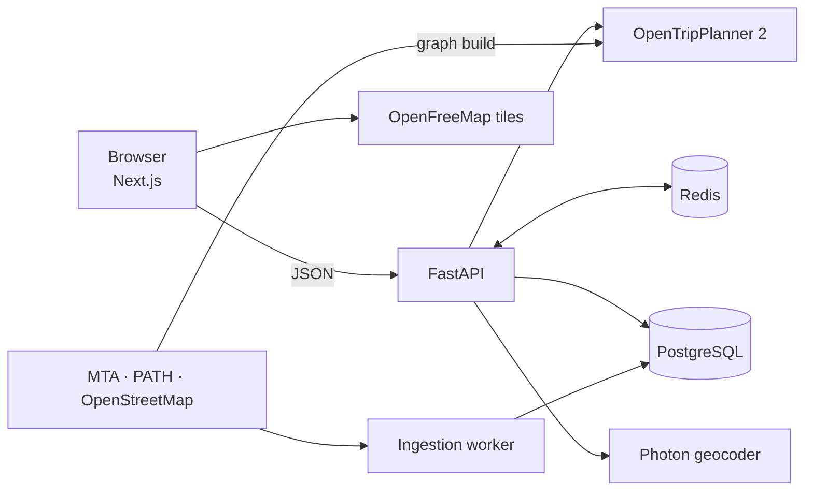

# SmartRouteNYC

[](https://github.com/VarshithaGudibandi/smart-route-nyc/actions/workflows/ci.yml)
[](LICENSE)

Accessibility-aware journey planning for New York City subway, bus and PATH.

Riders say what they need, such as step-free access, a wheelchair, less walking or fewer transfers, and SmartRouteNYC finds routes that respect it. A hard requirement is treated as a requirement, not a preference: every station and walk on a route is checked against live elevator data, and anything that cannot be confirmed is shown as such, never as accessible.

Everything runs locally in Docker from free, open data. No accounts, API keys or paid services.

## What you get

- **Real routing.** Every journey comes from [OpenTripPlanner 2](https://www.opentripplanner.org/) over the official MTA and PATH timetables and the OpenStreetMap street network.
- **Honest accessibility.** Each station and walk is marked *meets*, *violates* or *unknown*, with the data's source and age. Routes that cannot be confirmed are listed separately under "Needs review", with every barrier named.
- **Faster transfers, verified.** After each search, a background job looks for changes OpenTripPlanner skipped, such as switching to the express, and shows one only after the routing engine confirms it arrives earlier.
- **Explanations that cannot invent facts.** Route explanations are built from computed facts; model wording is accepted only if every sentence is grounded in them.
- **Private by design.** No accounts, no stored locations or route history; feedback is anonymous.
- **Accessible web app.** Keyboard and screen-reader support, status shown by shape and words as well as colour, and automated accessibility checks on every screen.

## How it works



A search, end to end:

1. The web app sends origin, destination, time and the rider's needs to `POST /api/v1/routes/search`.
2. The API asks OpenTripPlanner for itineraries, caching results in Redis and sharing one computation between identical concurrent searches.
3. Every station and walk is assessed against the latest elevator status and OpenStreetMap; routes that miss a requirement move to "Needs review".
4. Routes return immediately. A background investigation then tests faster transfers and the web app polls for verified ones.
5. The worker refreshes elevator outages and service alerts every two minutes and tracks how fresh each source is.

## Stack

- **Web app:** Next.js, React, TypeScript, MapLibre GL ([`frontend/`](frontend/README.md))
- **API and worker:** Python, FastAPI, Pydantic v2, SQLAlchemy, Alembic ([`backend/`](backend/README.md))
- **Routing:** OpenTripPlanner 2 with GTFS and OpenStreetMap ([`otp/`](otp/README.md))
- **Data and infrastructure:** PostgreSQL, Redis, Docker Compose, Prometheus, Grafana
- **Quality:** pytest, Testcontainers, Vitest, Playwright, axe-core, k6, GitHub Actions

## Run it yourself

**You need:** [Docker](https://docs.docker.com/get-docker/) with **8 GB of memory** available to it (Docker Desktop → Settings → Resources), and about 5 GB of disk. Runs on Linux, macOS (Intel or Apple silicon) and Windows through [WSL 2](https://learn.microsoft.com/windows/wsl/install); the setup is tested end to end on Linux.

```bash
git clone https://github.com/VarshithaGudibandi/smart-route-nyc.git
cd smart-route-nyc
./start.sh
```

Then open **http://localhost:3000**.

The first run takes 10 to 15 minutes: it downloads the current timetables and street map (about 220 MB), builds the routing graph, starts every service and waits for live elevator data. Later starts take about a minute.

| Command | What it does |
|---|---|
| `./start.sh` | Start, or set everything up on the first run |
| `./start.sh --with-dashboards` | Also start Prometheus and Grafana (http://localhost:3001) |
| `./start.sh --refresh` | Rebuild the graph from the latest timetables; the old graph keeps serving until the new one passes its checks |
| `./start.sh --stop` | Stop everything; data and the graph are kept |

The graph covers up to 60 days of service, less if a published timetable ends sooner; http://localhost:8000/api/v1/data/freshness shows when. Interactive API docs are at http://localhost:8000/api/docs. All ports are bound to `127.0.0.1`.

### Troubleshooting

| Symptom | Fix |
|---|---|
| "Docker has N GB of memory" | Raise Docker's memory to 8 GB and restart Docker |
| "Port … is already in use" | Stop the program using it (often a local PostgreSQL or Redis); `lsof -i :5432` shows which |
| A download fails | Downloads retry for about ten minutes and resume. The street map mirror is volunteer-run and sometimes briefly unreachable; run `./start.sh` again later, and verified files are reused |
| Graph build exits with code 137 | Docker ran out of memory; raise its limit |
| "The API did not become ready" | `docker compose logs --tail 50 otp backend` |
| Start over | `./start.sh --stop`, delete `data/otp/graph`, run `./start.sh` |

## API

| Endpoint | Purpose |
|---|---|
| `POST /api/v1/routes/search` | Routes for a trip, each with its accessibility verdict and evidence |
| `GET /api/v1/routes/investigations/{id}` | Faster transfers verified in the background (`DELETE` cancels) |
| `POST /api/v1/routes/explain` | A grounded explanation of a route from a recent search |
| `POST /api/v1/preferences/interpret` | Turn a rider's own words into needs for them to confirm |
| `GET /api/v1/places?q=` | Stations, then addresses |
| `POST /api/v1/feedback` | 1 to 5 stars and an optional comment, no account |
| `GET /api/v1/data/freshness` | How current each data source is |
| `GET /api/v1/health/live`, `/ready` | Liveness, and readiness of PostgreSQL, Redis and OpenTripPlanner |

Behaviour, limits and the accessibility rules are documented in [`backend/README.md`](backend/README.md).

## Evaluations

| What | Result |
|---|---|
| Typed preferences (30 labelled requests, keyword baseline) | 100% recall on wheelchair and step-free needs, no false positives, injection attempts handled |
| Explanation grounding (23 scripted model replies) | All 18 unfaithful or malformed replies rejected; 2 known gaps documented |
| Transfer suggestions (240 live searches) | Verified faster route for 6.6% of applicable searches, saving up to 13 minutes |

Cases, metrics and commands are in [`backend/README.md`](backend/README.md#evaluations). The first two run in CI.

## Development

You need Python 3.12 with [uv](https://docs.astral.sh/uv/) and Node.js 22.

```bash
pip install pre-commit && pre-commit install   # lint, format and secret checks on commit

(cd backend && uv sync && uv run pytest)       # API tests (integration tests use Docker)
(cd frontend && npm ci && npm test)            # web app tests; npm run test:e2e for browser tests
load/run.sh                                    # k6 load tests against the running stack
```

CI runs linting, type checks, all tests, evaluations, dependency audits and image scans on every push.

## Repository structure

```text
backend/        FastAPI API, ingestion worker, evaluations
frontend/       Next.js web app and browser tests
otp/            OpenTripPlanner config and graph-build scripts
load/           k6 load tests
observability/  Prometheus and Grafana configuration
start.sh        One-command local setup
```

## Data sources and attribution

MTA GTFS and GTFS-Realtime feeds and elevator data, the PATH GTFS schedule, and OpenStreetMap data (© OpenStreetMap contributors, ODbL) via [BBBike](https://download.bbbike.org/osm/). Maps by [OpenFreeMap](https://openfreemap.org); address search by [Photon](https://photon.komoot.io). Each source is used under its own terms, and no downloaded data is committed.

## License

[MIT](LICENSE) © Varshitha Gudibandi
