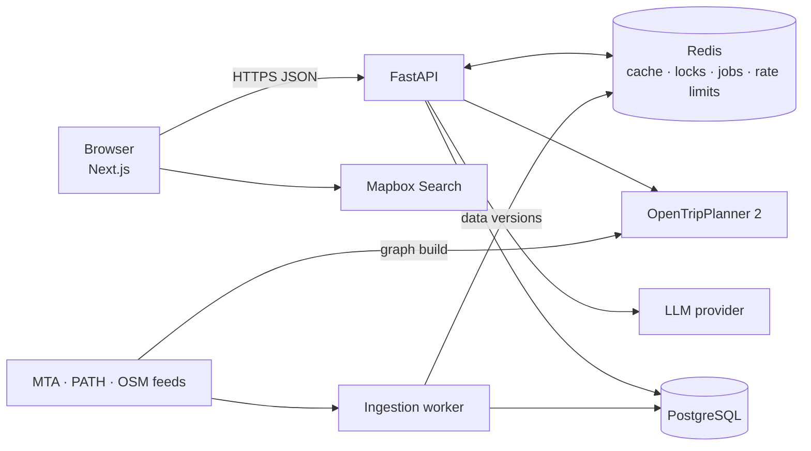

# SmartRouteNYC

[](https://github.com/VarshithaGudibandi/smart-route-nyc/actions/workflows/ci.yml)
[](LICENSE)

Accessibility-aware journey planning for New York City subway, bus and PATH.

SmartRouteNYC compares multimodal journeys against each rider's individual needs, such as step-free access, wheelchair access, less walking or fewer transfers. It treats a hard accessibility requirement as a requirement, not a preference. Every route is computed by a real transit routing engine. Each transfer reports what is known, what is violated and what is unknown, along with how fresh the underlying data is.

> **Status:** in active development. See the [roadmap](#roadmap) for what is implemented.

## Highlights

- **Deterministic routing.** Journeys are calculated by [OpenTripPlanner 2](https://www.opentripplanner.org/) from official GTFS schedules and OpenStreetMap, covering MTA subway, MTA bus and PATH.
- **Evidence-based accessibility.** Each segment and transfer is classified as `meets`, `violates` or `unknown`. Live elevator outages and source freshness are checked every time a result is served. A stale feed downgrades a claim to `unknown`; it never upgrades one.
- **Verified AI route suggestions.** An LLM proposes specific transfer experiments, such as switching to the express for part of the trip. Each one is enforced and timed by the routing engine before it can be shown. Unverified suggestions are discarded, never displayed.
- **Fast first results.** Baseline routes return immediately. AI investigation runs as a background job, and verified improvements are added when it finishes.
- **Built for reliability.** Redis-backed caching with versioned invalidation, deduplication of identical in-flight searches, distributed rate limiting, timeouts, jittered retries and circuit breakers on every external dependency.
- **Privacy by design.** No accounts and no stored locations or route histories. Feedback is anonymous.

## Architecture



| Component | Responsibility |
|---|---|
| **Frontend** (Next.js, TypeScript) | Place search, current location, preferences, route comparison, map, transfer details |
| **API** (FastAPI, Pydantic v2) | Validation, search coordination, accessibility assessment, AI job orchestration |
| **OpenTripPlanner** | Multimodal itinerary computation over the GTFS + OSM graph |
| **Redis** | Cache-aside for routing and LLM results, distributed locks, background job state, rate limiting |
| **PostgreSQL** | Elevator and escalator status, data provenance, anonymous feedback |
| **Ingestion worker** | Scheduled fetching of MTA and PATH feeds, idempotent upserts, freshness tracking |

## Tech stack

- **Backend:** Python, FastAPI, Pydantic v2, SQLAlchemy 2 (async), Alembic, Redis
- **Frontend:** Next.js, React, TypeScript, Tailwind CSS
- **Routing:** OpenTripPlanner 2, GTFS, GTFS-Realtime, OpenStreetMap
- **Infrastructure:** Docker Compose, GitHub Actions, Prometheus, Grafana, OpenTelemetry
- **Testing:** pytest, Testcontainers, Playwright, k6

## Repository layout

```text
backend/      FastAPI application, API schemas, services, integrations
frontend/     Next.js web application
ingestion/    Scheduled transit and accessibility feed ingestion
otp/          OpenTripPlanner configuration and graph-build scripts
infra/        Docker Compose, observability configuration, load tests
```

Directories are added as each component is implemented.

## Getting started

Prerequisites: Docker with Compose, Python 3.12 and Node.js 20. OpenTripPlanner runs in Docker, so no local Java install is needed.

```bash
git clone https://github.com/VarshithaGudibandi/smart-route-nyc.git
cd smart-route-nyc
cp .env.example .env
pip install pre-commit && pre-commit install
```

**Routing engine.** Building and serving the OpenTripPlanner graph is described in [`otp/README.md`](otp/README.md).

Setup for the remaining services will be documented here as they are added.

## Roadmap

- [x] Repository foundation: tooling, CI, conventions
- [ ] Transit data pipeline and OpenTripPlanner graph for NYC + PATH
- [ ] Backend foundation: API skeleton, PostgreSQL, Redis, observability
- [ ] Route search with caching, deduplication and rate limiting
- [ ] Feed ingestion: schedules, realtime updates, elevator outages
- [ ] Accessibility assessment engine
- [ ] Natural-language preference interpretation
- [ ] Asynchronous AI route investigation with routing-engine verification
- [ ] Grounded route explanations and anonymous feedback
- [ ] Web application
- [ ] Load testing, dashboards, end-to-end tests and deployment

## Data sources and attribution

Planned sources: the MTA's public GTFS and GTFS-Realtime feeds, PATH's published GTFS schedule, and OpenStreetMap data (© OpenStreetMap contributors, ODbL). Each source is used under its own terms, and none of the downloaded data is committed to this repository.

## License

[MIT](LICENSE) © Varshitha Gudibandi
