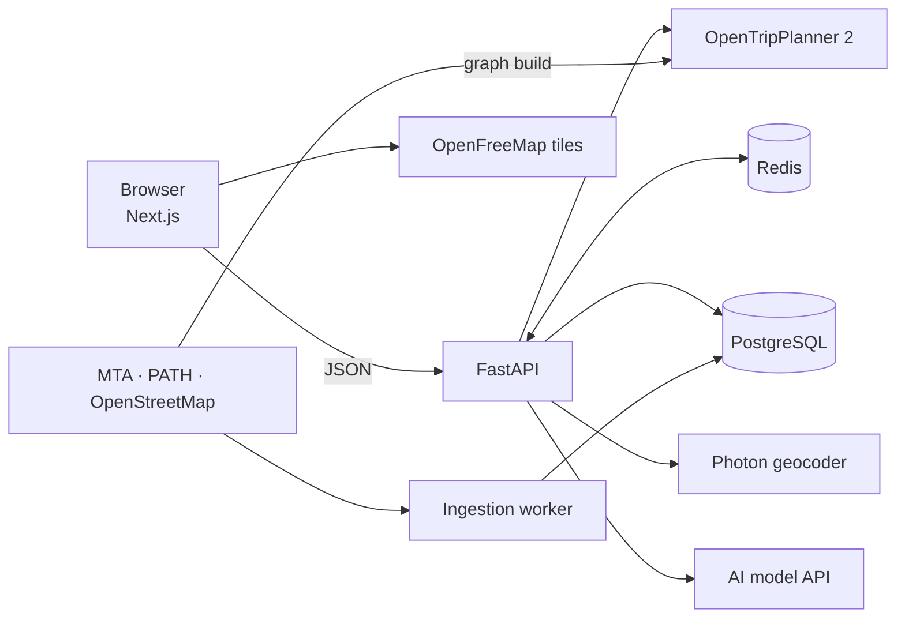

# SmartRouteNYC

Accessibility-aware journey planning for New York City subway, bus and PATH.

Riders say what they need, such as step-free access, a wheelchair, less walking or fewer transfers. [OpenTripPlanner](https://www.opentripplanner.org/) computes the routes, and an AI model builds on them: it reads needs written in plain words, looks for faster transfers the routing engine skipped, and summarizes each route. Every station and walk is checked against live elevator data, and whatever the model proposes is verified against the timetable and route data before it is shown.

Runs locally in Docker on open transit data. The AI features work with an API key from any provider (Claude, OpenAI, Gemini, Groq, OpenRouter, or a local Ollama model); without one, they fall back to deterministic rules.

## What you get

- **Routing on real data.** Journeys come from OpenTripPlanner 2 over the official MTA and PATH timetables and the OpenStreetMap street network.
- **AI that builds on the routes.** The model turns "I use a wheelchair and hate changing trains" into search settings, proposes faster transfers (say, switching to the express for part of the trip), and summarizes routes in plain language.
- **Checked before it is shown.** The model's transfer ideas are timed by OpenTripPlanner and kept only if they arrive earlier; its explanations are kept only if every sentence matches the route data.
- **Clear accessibility.** Each station and walk is marked *meets*, *violates* or *unknown*, with the data's source and age. Routes that cannot be confirmed are listed under "Needs review" with each barrier named.
- **Private.** No accounts, no stored locations or route history; feedback is anonymous.
- **Accessible web app.** Keyboard and screen-reader support, status shown by shape and words as well as colour, and automated accessibility checks on every screen.

## How it works



A search, end to end:

1. The web app sends origin, destination, time and the rider's needs to `POST /api/v1/routes/search`.
2. The API asks OpenTripPlanner for itineraries, caching results in Redis and sharing one computation between identical concurrent searches.
3. Every station and walk is assessed against the latest elevator status and OpenStreetMap; routes that miss a requirement move to "Needs review".
4. Routes return immediately. In the background, the model and a set of rules propose faster transfers; OpenTripPlanner times each one, and the web app shows those that arrive earlier.
5. On request, the model summarizes a route in a few sentences from facts the API computes (legs, transfers, elevator status, alerts), and each sentence is checked against them.
6. The worker refreshes elevator outages and service alerts every two minutes.

### Where AI is used

| Feature | What the model does | How it is checked | Without an API key |
|---|---|---|---|
| Typed needs | Turns a rider's words into search settings for them to confirm | Strict schema; text can add a requirement but never remove one the rider set | Keyword rules (also used if a model call fails) |
| Faster transfers | Proposes transfers from the timetable facts of the trip | IDs must exist, lines must run there, and OpenTripPlanner must confirm an earlier arrival | Rule-based proposals only |
| Route summaries | Summarizes the route in 2 to 5 sentences | Every number, name and accessibility claim must appear in the cited facts | The key facts, as sentences |

Every call has a timeout, one retry, a circuit breaker and a daily call limit (`LLM_DAILY_CALL_LIMIT`). The code is in [`backend/app/ai/`](backend/app/ai): Claude goes through Anthropic's SDK, and every other provider through the OpenAI-compatible chat API they all offer.

## Stack

- **Web app:** Next.js, React, TypeScript, MapLibre GL ([`frontend/`](frontend/README.md))
- **API and worker:** Python, FastAPI, Pydantic v2, SQLAlchemy, Alembic ([`backend/`](backend/README.md))
- **Routing:** OpenTripPlanner 2 with GTFS and OpenStreetMap ([`otp/`](otp/README.md))
- **Data and infrastructure:** PostgreSQL, Redis, Docker Compose, Prometheus, Grafana
- **Quality:** pytest, Testcontainers, Vitest, Playwright, axe-core, k6, GitHub Actions

## Run it yourself

**You need:** [Docker](https://docs.docker.com/get-docker/) with **8 GB of memory** available to it (Docker Desktop → Settings → Resources), and about 5 GB of disk. Runs on Linux, macOS (Intel or Apple silicon) and Windows through [WSL 2](https://learn.microsoft.com/windows/wsl/install); the setup is tested end to end on Linux.

```bash
git clone https://github.com/VarshithaGudibandi/smart-route-nyc.git
cd smart-route-nyc
./start.sh
```

Then open **http://localhost:3000**.

**To turn on the AI features**, add a key to the `.env` file the first run creates, then run `./start.sh` again:

```bash
LLM_API_KEY=sk-...          # any provider's key
LLM_MODEL=gpt-5-mini        # the model to call (Claude keys default to claude-opus-5-5)
LLM_BASE_URL=https://api.openai.com/v1   # only for non-Claude providers; examples in .env.example
```

The first run takes 10 to 15 minutes: it downloads the current timetables and street map (about 220 MB), builds the routing graph, starts every service and waits for live elevator data. Later starts take about a minute.

| Command | What it does |
|---|---|
| `./start.sh` | Start, or set everything up on the first run |
| `./start.sh --with-dashboards` | Also start Prometheus and Grafana (http://localhost:3001) |
| `./start.sh --stop` | Stop everything; data and the graph are kept |

Interactive API docs are at http://localhost:8000/api/docs. The graph covers the timetables published when it was built; to use newer ones, delete `data/otp/graph` and run `./start.sh` again.

### See what it is doing

| What | Where |
|---|---|
| Each request, its timing and cache result, and every AI call with its model, latency and token counts | `docker compose logs -f backend` |
| Elevator, alert and feed updates | `docker compose logs -f worker` |
| What the background transfer search found, and how many ideas were rejected for each reason | `GET /api/v1/routes/investigations/{id}` (the id comes with each search response); every idea's outcome is also stored in the `suggestion_outcomes` table |
| Charts of traffic, latency, cache, OpenTripPlanner and data age | `./start.sh --with-dashboards`, then http://localhost:3001 |

## API

| Endpoint | Purpose |
|---|---|
| `POST /api/v1/routes/search` | Routes for a trip, each with its accessibility verdict and evidence |
| `GET /api/v1/routes/investigations/{id}` | Faster transfers verified in the background (`DELETE` cancels) |
| `POST /api/v1/routes/explain` | A grounded explanation of a route from a recent search |
| `POST /api/v1/preferences/interpret` | Turn a rider's own words into needs for them to confirm |
| `GET /api/v1/places?q=` | Stations, then addresses |
| `POST /api/v1/feedback` | 1 to 5 stars and an optional comment, no account |
| `GET /api/v1/data/freshness` | How current each data source is |
| `GET /api/v1/health/live`, `/ready` | Liveness, and readiness of PostgreSQL, Redis and OpenTripPlanner |

Behaviour, limits and the accessibility rules are documented in [`backend/README.md`](backend/README.md).

## Evaluations

| What | Result |
|---|---|
| Typed preferences (30 labelled requests, keyword baseline) | 100% recall on wheelchair and step-free needs, no false positives, injection attempts handled |
| Explanation grounding (23 scripted model replies) | All 18 unfaithful or malformed replies rejected; 2 known gaps documented |
| Transfer suggestions (240 live searches, rule-based proposals) | Verified faster route for 6.6% of applicable searches, saving up to 13 minutes |

Each evaluation also runs against the configured model (`--provider model`, `--live N`, `--generator model`), to compare it with the rules. Cases, metrics and commands are in [`backend/README.md`](backend/README.md#evaluations). The first two run in CI.

## Development

You need Python 3.12 with [uv](https://docs.astral.sh/uv/) and Node.js 22.

```bash
pip install pre-commit && pre-commit install   # lint, format and secret checks on commit

(cd backend && uv sync && uv run pytest)       # API tests (integration tests use Docker)
(cd frontend && npm ci && npm test)            # web app tests; npm run test:e2e for browser tests
ops/load/run.sh                                # k6 load tests against the running stack
```

CI runs linting, type checks, all tests, evaluations, dependency audits and image scans on every push. A separate workflow, started by hand, runs `./start.sh` on a fresh machine and load-tests it.

## Repository structure

```text
backend/        FastAPI API, ingestion worker, evaluations
frontend/       Next.js web app and browser tests
otp/            OpenTripPlanner config and graph-build scripts
ops/            k6 load tests, Prometheus and Grafana configuration
start.sh        One-command local setup
```

## Data sources and attribution

MTA GTFS and GTFS-Realtime feeds and elevator data, the PATH GTFS schedule, and OpenStreetMap data (© OpenStreetMap contributors, ODbL) via [BBBike](https://download.bbbike.org/osm/). Maps by [OpenFreeMap](https://openfreemap.org); address search by [Photon](https://photon.komoot.io). Each source is used under its own terms, and no downloaded data is committed.

## License

[MIT](LICENSE) © Varshitha Gudibandi
